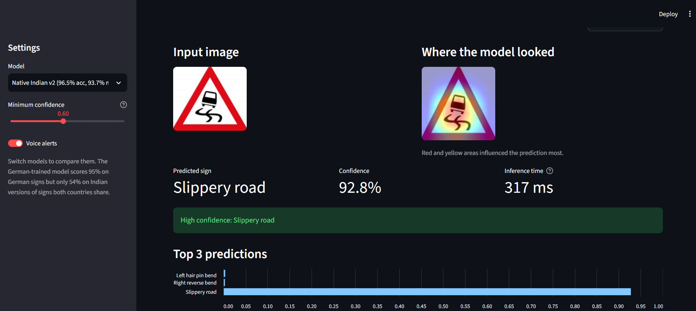
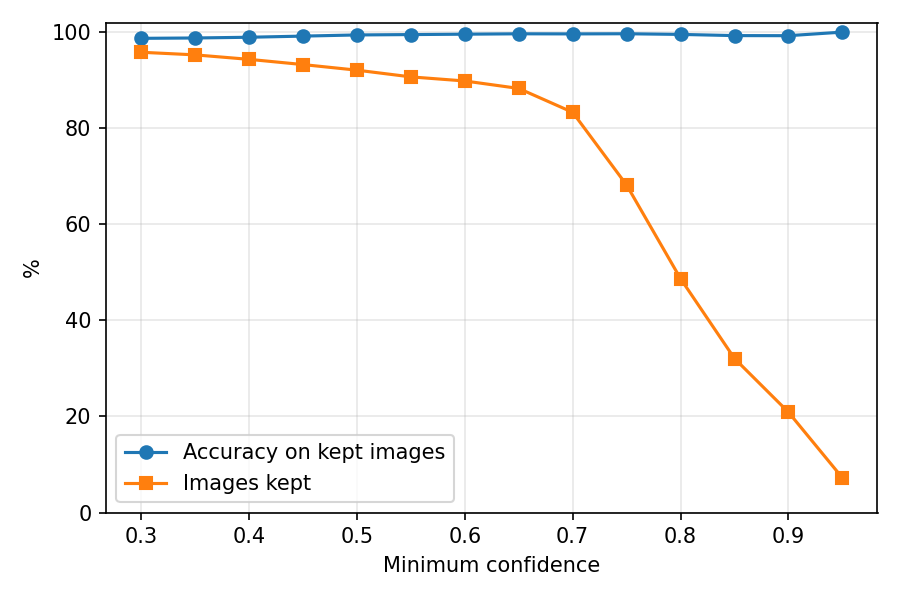
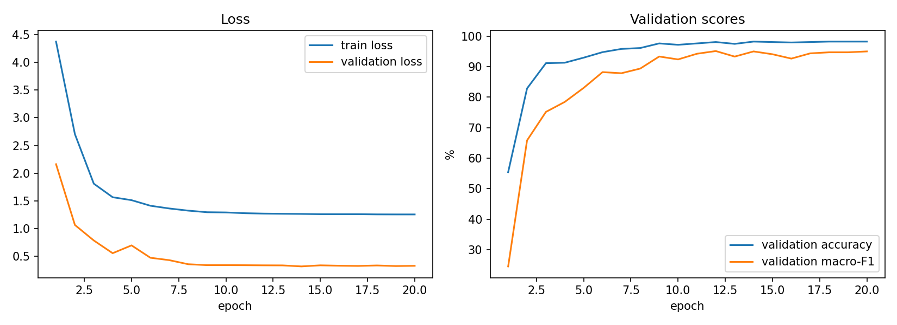
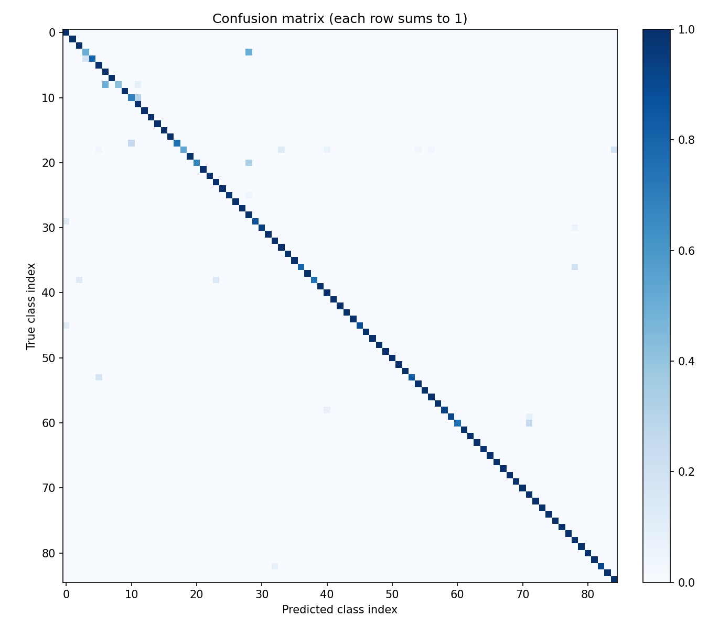
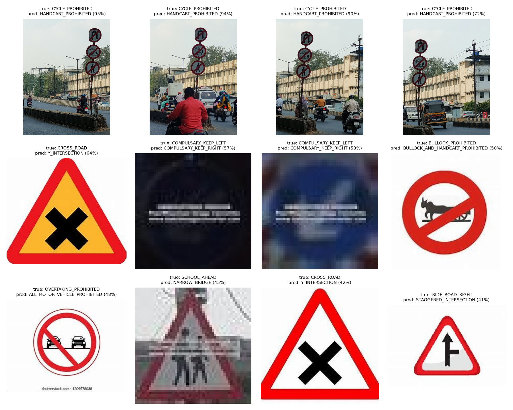

# Indian Traffic Sign Recognition (Explainable ResNet18)

A ResNet18 classifier for **85 classes of Indian road signs**, with Grad-CAM explanations, confidence-based rejection of unreliable inputs, and an interactive Streamlit app. The project also measures, with a fair protocol, how well a German-trained model transfers to Indian signs.

**Live demo:** [https://github.com/Anamika74/Intelligent-Traffic-Sign-Classification-System]



## Results

All numbers below come from `Notebooks/kaggle_retrain_and_evaluate.ipynb` (3 random seeds) and `scripts/evaluate_model.py`.

### Final model

| Metric (ITSD test set, 1,288 images, 85 classes) | Score |
|---|---|
| Accuracy | 96.35% |
| Macro-F1 (every class counts equally) | 93.5% |
| Weighted-F1 | 96.35% |
| Inference time, laptop CPU, including Grad-CAM | about 150 ms per image |

Across 3 seeds the improved recipe reaches **96.5 ± 0.4% accuracy and 93.7 ± 0.5% macro-F1**. The saved model is the seed with the best *validation* macro-F1.

### Improving the training recipe

Same train/validation split for every row; the test set is used once per run.

| Setup (3 seeds each) | Accuracy % | Macro-F1 % |
|---|---|---|
| Original recipe (3 epochs, rotation-only augmentation), ImageNet start | 88.1 ± 0.2 | 67.4 ± 0.7 |
| **Improved recipe, ImageNet start** | **96.5 ± 0.4** | **93.7 ± 0.5** |
| Improved recipe, German-signs (GTSRB) start | 96.2 ± 0.5 | 92.8 ± 0.6 |

| | Original | Improved |
|---|---|---|
| Epochs | 3 | 20, best epoch chosen on validation macro-F1 |
| Augmentation | rotation | rotation, shift, zoom, colour jitter, blur (**no horizontal flip**: left and right signs are different classes) |
| Class imbalance | none | loss weights of 1/sqrt(class frequency) |
| Label smoothing | none | 0.1 |
| Learning rate | fixed | one-cycle schedule |

Starting from German-sign weights or ImageNet weights gives about the same result once the recipe is good; the difference is within the seed-to-seed spread.

The very first version of this project (trained 3 epochs on the full training set) scored 91.15% accuracy and 74.6% macro-F1. The large macro-F1 gap showed that the model was weak on rare classes, and left/right mirror pairs were its most common mistakes. The improved recipe above was designed to fix exactly that.

### Does a German-trained model work on Indian signs?

A 43-class German (GTSRB) model can only be tested on signs that exist in both countries. I ran the real German model on the Indian test images of 19 shared sign types (562 images) and counted a prediction as correct only if it mapped to the right Indian class.

| Model | Test images | Accuracy |
|---|---|---|
| German model | German test set | 95.0% |
| German model | Indian versions of 19 shared signs | **54.4%** |
| Indian-trained model | the same Indian images | **99.8%** |

Stop, give way and cycle crossing transfer perfectly. Speed limits 50 and 70, left curve and traffic signal transfer very badly (see `docs/cross_domain_per_sign.csv`). The matching of German to Indian classes is my own judgement and is listed in the notebook (Step 12).

### Confidence and rejection

The app shows the top-3 probabilities and refuses to name a sign below a confidence threshold (default 0.60). On the test set, that threshold keeps about 91% of images at roughly 99.5% accuracy (`docs/confidence_vs_accuracy.png`). Out-of-scope inputs such as a "no smoking" sign are rejected instead of being forced into one of the 85 classes.





## Explainability (Grad-CAM)

Grad-CAM hooks the last convolutional block (`layer4[-1]`) and highlights the pixels that most influenced the prediction. It runs on the same forward pass as the prediction, so it adds little time. The app shows the original and the heatmap side by side.

## Where it still fails

Weakest classes on the test set (images in brackets): `COMPULSARY_AHEAD_OR_TURN_RIGHT` 41.7% (12), `CROSS_ROAD` 53.1% (32), `CYCLE_PROHIBITED` 66.7% (12), `COMPULSARY_KEEP_LEFT` 68.8% (16). Looking at the worst errors (`docs/worst_errors.png`) shows that most are data problems rather than model problems:

- Several test photos show **one pole with three stacked signs** but carry a single label, so the model's answer can be defensible and still count as wrong.
- Some images are **dark, tiny or have horizontal streak artifacts** in the source files and cannot be read by anyone.
- A few classes are near-identical pairs (for example bullock cart vs bullock and hand cart prohibited).
- Confident mistakes caused by label noise are not caught by the confidence threshold.



## Limitations

- The model classifies **tightly cropped signs**. It is not a detector, so full street photos with many signs give unreliable results (the app flags most of them as low confidence).
- Splits are random. The dataset contains several photos of the same physical signs from slightly different angles, so some near-duplicates may sit on both sides of the split and the scores may be somewhat optimistic.
- Rare classes have only 1 to 5 test images, so their individual scores are noisy.
- Voice alerts use the browser's speech engine and may need a click to start, depending on the browser.
- Trained and tested on a single Indian dataset (ITSD). Other cameras, regions and weather were not tested.

## Run it locally

```bash
git clone https://github.com/Anamika74/Intelligent-Traffic-Sign-Classification-System.git
cd Intelligent-Traffic-Sign-Classification-System
pip install -r requirements.txt   
```

The final model, `models/native_indian_v2.pth` (about 43 MB), is included in the repository, and `classes_indian.json` holds the class names in training order. The app lists only the models whose weight files are present in `models/`.

```bash
streamlit run app.py          # the app
python -m pytest              # tests (no weights needed)
python scripts/quick_check.py     # accuracy of the selected model on the test folder
python scripts/evaluate_model.py  # full metrics, confusion matrix, worst errors
```

`scripts/*.py` expect the ITSD test folder at `Datasets/ITSD/test` (override with `--data`). The datasets are not included; both come from Kaggle (the Indian traffic sign dataset with 85 classes, and the GTSRB German traffic sign dataset).

## Project structure

```
app.py                  Streamlit interface (Predict, Experiments, About tabs)
src/
  model.py              model registry and loading
  predict.py            preprocessing, top-3, confidence, timing
  gradcam.py            Grad-CAM (returns image arrays)
  voice.py              browser speech alerts with cooldown
  metrics.py, report.py evaluation metrics and plots
scripts/                quick_check.py, evaluate_model.py
Notebooks/              kaggle_retrain_and_evaluate.ipynb (training and all experiments)
tests/                  smoke tests and metric tests
docs/                   charts and tables used in this README
classes_indian.json     class names in the exact order used for training
```


## Tech stack

Python, PyTorch, torchvision, OpenCV, Streamlit, pandas, matplotlib. Trained on Kaggle GPUs.

## Author

Anamika Sharma. [GitHub](https://github.com/Anamika74)